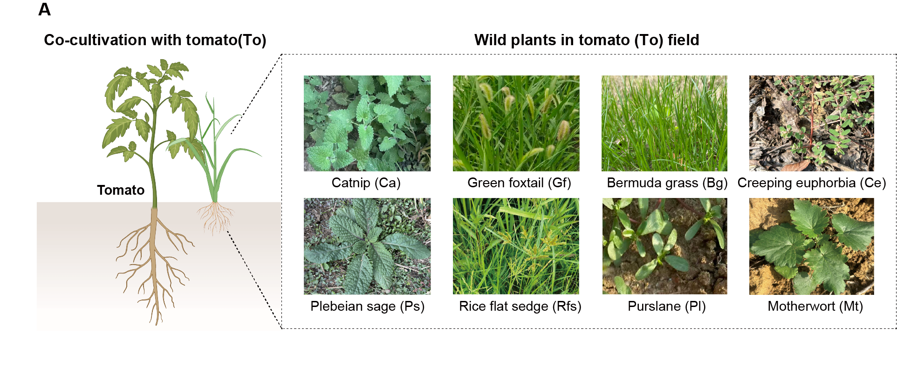

```{r setup, include=FALSE}
knitr::opts_chunk$set(echo = TRUE)
# Clean workspace
rm(list=ls()) 
# Set output directory
output_dir="./"
# Loading package
library(readxl)
```

## A. Eight weed species

A)  Eight weed species consistently occurring in tomato fields at the Baima Experimental Station of Nanjing Agricultural University (Nanjing, Jiangsu Province, China) were selected and individually co-cultivated with tomato to evaluate their potential effects on bacterial wilt incidence and plant growth.




## B. Disease incidence

（B）Disease incidence of tomato bacterial wilt following R. solanacearum infection, and the dry weight of tomato shoots in the absence of pathogen stress, under co-cultivation with different weed species.

```{r Disease_incidence}
library(ggplot2)
library(Rmisc)
library(ggpubr)
library(DescTools)

group_order <- c("CK", "Ca", "Gf", "Bg", "Ce","Ps", "Rfs", "Pl", "Mt")
#Fig1B1
Data_Fig1B1 <- read_excel("../data/Source Data Fig. 1.xlsx",sheet = "Fig1B2")
Data_Fig1B1$group<-factor(Data_Fig1B1$group,levels = group_order)

SE<-summarySE(data = Data_Fig1B1,measurevar = "incidences",groupvars = "group")
SE$group<-factor(SE$group,levels = group_order)
SE <- SE[order(SE$group), ]

set.seed(123)
dunnett <- DunnettTest(x=Data_Fig1B1$incidences, g=Data_Fig1B1$group)$CK
sig_df <- subset(transform(as.data.frame(dunnett),group = sub("-CK$", "", rownames(dunnett))),pval < 0.05)
sig_df$y <- SE$incidences[match(sig_df$group, SE$group)] + SE$se[match(sig_df$group, SE$group)] + 4
sig_df$label <- paste0("P = ", signif(sig_df$pval, 2))


Fig1B1 <- ggplot()+
  geom_rect(aes(ymin=quantile(Data_Fig1B1[[2]][1:4], 0.25),ymax=quantile(Data_Fig1B1[[2]][1:4], 0.75),xmin=-Inf,xmax=Inf),fill="gray",alpha=0.5)+
  geom_errorbar(data=SE[2:9,],aes(x=group,ymin=incidences-se, ymax=incidences+se,color=group),width=0,position=position_dodge(0),linewidth=0.45)+
  geom_point(data=SE[2:9,],aes(x=group,y=incidences,color=group,fill=group),shape=21,size=1,stroke=0.6)+
  scale_color_manual(values = c("#5a5a58","#5a5a58","#5a5a58","#5a5a58","#5a5a58","#5a5a58","#5a5a58","#3d89a3"))+
  scale_fill_manual(values = c("white","white","white","white","white","white","white","#3d89a3"))+
  geom_text(data = sig_df,aes(x = group, y = y, label = label),angle = 90,hjust = 0,size = 2.5,fontface = "italic")+
scale_y_continuous(limits = c(-5, 100))+
  labs(x='',y='Disease\nincidence (%)')+
  theme_classic2()+
  theme(axis.text = element_text(size = 7,color="black"),
        axis.title = element_text(size = 7,color="black"),
        axis.ticks = element_line(size=0.25),
        axis.ticks.length = unit(0.05, "cm"),
        axis.line = element_line(size=0.25),
        legend.position = "none")

ggsave(paste0(output_dir, "Fig1B1.pdf", sep=""), Fig1B1, width = 4, height = 2)
Fig1B1


#Fig1B2
Data_Fig1B2 <- read_excel("../data/Source Data Fig. 1.xlsx",sheet = "Fig1B1")
Data_Fig1B2$group<-factor(Data_Fig1B2$group,levels = group_order)

SE<-summarySE(data = Data_Fig1B2,measurevar = "dry weight",groupvars = "group")
SE$group<-factor(SE$group,levels = group_order)
SE <- SE[order(SE$group), ]

set.seed(123)
dunnett <- DunnettTest(x=Data_Fig1B2$`dry weight`, g=Data_Fig1B2$group)$CK
sig_df <- subset(transform(as.data.frame(dunnett),group = sub("-CK$", "", rownames(dunnett))),pval < 0.05)
sig_df["Mt-CK",] <- c(dunnett["Mt-CK",],"Mt")
sig_df$y <- SE$`dry weight`[match(sig_df$group, SE$group)] + SE$se[match(sig_df$group, SE$group)] + 0.1
sig_df$label <- paste0("P = ", signif(as.numeric(sig_df$pval), 2))


Fig1B2 <- ggplot()+
  geom_rect(aes(ymin=quantile(Data_Fig1B2[[2]][97:108], 0.25),ymax=quantile(Data_Fig1B2[[2]][97:108], 0.75),xmin=-Inf,xmax=Inf),fill="gray",alpha=0.5)+
  geom_errorbar(data=SE[2:9,],aes(x=group,ymin=`dry weight`-se, ymax=`dry weight`+se,color=group),width=0,position=position_dodge(0),linewidth=0.45)+
  geom_point(data=SE[2:9,],aes(x=group,y=`dry weight`,color=group,fill=group),shape=21,size=1,stroke=0.6)+
  scale_color_manual(values = c("#5a5a58","#5a5a58","#5a5a58","#5a5a58","#5a5a58","#5a5a58","#5a5a58","#3d89a3"))+
  scale_fill_manual(values = c("white","white","white","white","white","white","white","#3d89a3"))+
  geom_text(data = sig_df,aes(x = group, y = y, label = label),angle = 90,hjust = 0,size = 2.5,fontface = "italic")+
  scale_y_continuous(limits = c(4.26, 5.5))+
  labs(x='',y='Aboveground\ndry weight (g)')+
  theme_classic2()+
  theme(axis.text = element_text(size = 7,color="black"),
        axis.title = element_text(size = 7,color="black"),
        axis.ticks = element_line(size=0.25),
        axis.ticks.length = unit(0.05, "cm"),
        axis.line = element_line(size=0.25),
        legend.position = "none")

ggsave(paste0(output_dir, "Fig1B2.pdf", sep=""), Fig1B2, width = 4, height = 2)
Fig1B2
```


## C. Bacterial wilt incidence

（C）Bacterial wilt incidence under different planting systems in non-sterilized and sterilized soils. Welch’s t-test.

```{r incidence}
library(agricolae)
library(dplyr)
Data_Fig1C <- read_excel("../data/Source Data Fig. 1.xlsx",sheet = "Fig1C")

SE<-summarySE(data = Data_Fig1C,measurevar = "incidence",groupvars = c("group","soil"))

p_df <- Data_Fig1C %>% group_by(soil) %>%
  summarise(p = t.test(incidence ~ group)$p.value,.groups = "drop") %>%
  filter(p < 0.05) %>%
  mutate(label = paste0("p = ", signif(p, 2)),y = 108 )

Fig1C <- ggplot(Data_Fig1C,aes(x=soil,y=incidence))+
  stat_summary(fun = mean, geom = "bar", width = 0.6,position = position_dodge(width = 0.8),
               aes(group=group),color="black",fill="white",linewidth = 0.3) +
  geom_errorbar(data = SE, aes(ymin = incidence - se, ymax = incidence + se, group = group), 
                color="black",width = 0.2, position = position_dodge(width = 0.8), alpha = 0.8, linewidth = 0.3)+
  geom_point(aes(color = group),fill="white",position = position_jitterdodge(dodge.width = 0.8,jitter.width = 0.25), size = 0.7,shape=21) +
  geom_text(data = p_df,aes(x = soil, y = y, label = label),inherit.aes = FALSE,size = 2.5,fontface = "italic")+
  scale_color_manual(values = c("#4aac44","#ff8c00"))+
  coord_cartesian(ylim = c(30, 110))+
  labs(x='',y='Disease incidence (%)',fill="",color="")+
  theme_classic2()+
  theme(axis.text = element_text(size = 7,color="black"),
        axis.text.x = element_text(size = 7,color="black",angle=30,hjust = 1),
        axis.title = element_text(size = 7,color="black"),
        axis.ticks = element_line(size=0.25),
        axis.ticks.length = unit(0.05, "cm"),
        axis.line = element_line(size=0.25),
        legend.position = "top",
        legend.key.size = unit(0.4,"cm"),
        legend.text = element_text(size = 6,color="black"))
ggsave(paste0(output_dir, "Fig1C.pdf", sep=""), Fig1C, width = 2, height = 3)
Fig1C
```


## D. Abundance of R. solanacearum

（D）Abundance of R. solanacearum in the tomato rhizosphere under different planting systems in non-sterilized and sterilized soils.

```{r abundance}
library(agricolae)
library(dplyr)
Data_Fig1D <- read_excel("../data/Source Data Fig. 1.xlsx",sheet = "Fig1D")

SE<-summarySE(data = Data_Fig1D,measurevar = "Ralstonia (log10copies/g)",groupvars = c("group","soil"))

p_df <- Data_Fig1D %>% group_by(soil) %>%
  summarise(p = t.test(`Ralstonia (log10copies/g)` ~ group)$p.value,.groups = "drop") %>%
  filter(p < 0.05) %>%
  mutate(label = paste0("p = ", signif(p, 2)),y = 9 )

Fig1D <- ggplot(data=Data_Fig1D,aes(x=soil,y=`Ralstonia (log10copies/g)`))+
  stat_summary(fun = mean, geom = "bar", width = 0.6,position = position_dodge(width = 0.8),
               aes(group=group),color="black",fill="white",linewidth = 0.3) +
  geom_errorbar(data = SE, aes(ymin = `Ralstonia (log10copies/g)` - se, ymax = `Ralstonia (log10copies/g)` + se, group = group,color=group), 
                color="black",width = 0.2, position = position_dodge(width = 0.8), alpha = 0.8, linewidth = 0.3)+
  geom_point(aes(color = group),fill="white",position = position_jitterdodge(dodge.width = 0.8,jitter.width = 0.25), 
             size = 0.7,shape=21) +
  geom_text(data = p_df,aes(x = soil, y = y, label = label),inherit.aes = FALSE,size = 2.5,fontface = "italic")+
  scale_color_manual(values = c("#4aac44","#ff8c00"))+
  coord_cartesian(ylim = c(4, 9))+
  labs(x='',y='Ralstonia abundance\n(log10copies/g dry soil)',fill="",color="")+
  theme_classic2()+
  theme(axis.text = element_text(size = 7,color="black"),
        axis.text.x = element_text(size = 7,color="black",angle=30,hjust = 1),
        axis.title = element_text(size = 7,color="black"),
        axis.ticks = element_line(size=0.25),
        axis.ticks.length = unit(0.05, "cm"),
        axis.line = element_line(size=0.25),
        legend.position = "top",
        legend.key.size = unit(0.4,"cm"),
        legend.text = element_text(size = 6,color="black"))
ggsave(paste0(output_dir, "Fig1D.pdf", sep=""), Fig1D, width = 2, height = 3)
Fig1D
```

