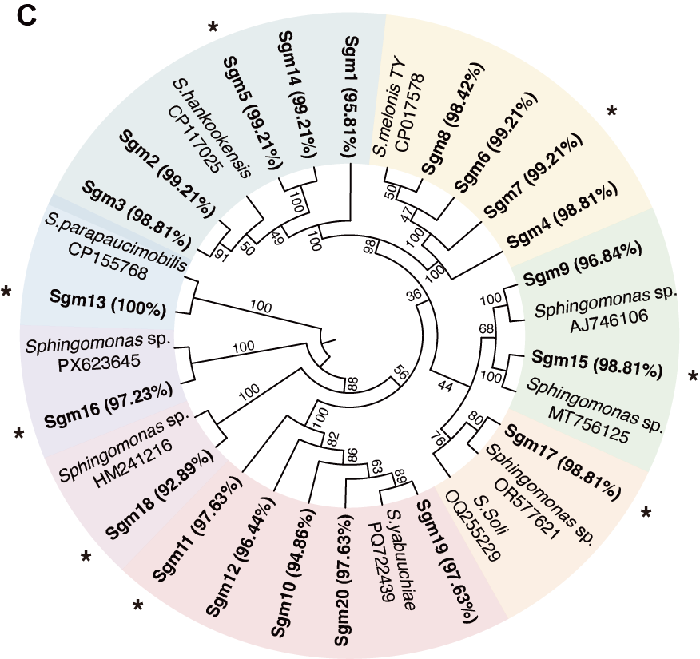
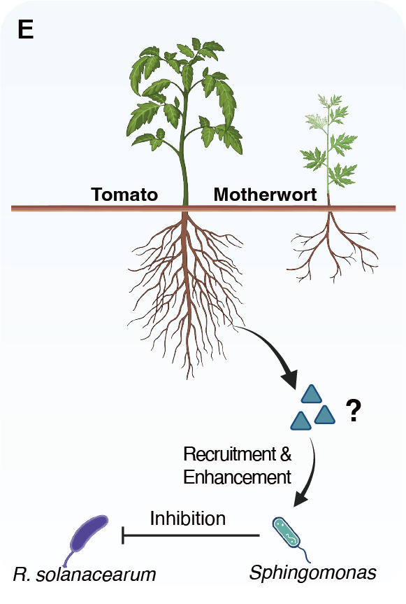

```{r setup, include=FALSE}
knitr::opts_chunk$set(echo = TRUE)
# Clean workspace
rm(list=ls()) 
# Set output directory
output_dir="./"
# Loading package
library(readxl)
```

## A. NMDS

A)  Non-metric multidimensional scaling (NMDS) analysis showing compositional differences in tomato rhizosphere bacterial communities across treatments.

```{r NMDS}
library(LorMe)
library(vegan)
library(dplyr)
library(ggplot2)

asv <- read.csv("../data/ASV_table.csv")
design <- read.csv("../data/design.csv")

alltax_summary <- tax_summary(groupfile = design, inputtable = asv[, 2:37], reads = TRUE, taxonomytable = asv[, c(1, 38)], outputtax = "standard")
innocu_tax_summary <- object_config(taxobj = alltax_summary, treat_location = 2, facet_location = 3, rep_location = 4)

asv_per <- innocu_tax_summary$Base_percent
rownames(asv_per) <- asv_per[, 1]
asv_per <- t(as.matrix(asv_per[, 2:37])) %>% as.data.frame()

df_nmds <- metaMDS(vegdist(decostand(asv_per, method = "hellinger"), method = "bray"), k = 2)
df_nmds_stress <- df_nmds$stress

df_points <- as.data.frame(df_nmds$points)
colnames(df_points) <- c("NMDS1", "NMDS2")
df_points$Sample <- rownames(df_points)

df_points <- left_join(df_points, design[, c("sampleID", "group", "RS")], by = c("Sample" = "sampleID"))
df_points$Group <- factor(df_points$group, levels = c("Mo.To", "Co.To", "Co.Mt"))
df_points$RS <- factor(df_points$RS, levels = c("Y", "N"))
df_points$group2 <- paste(df_points$Group, df_points$RS, sep = "_")

adonis2(asv_per ~ RS * Group, data = df_points, distance = "euclidean", permutations = 999, by = "terms")

cols <- rep(c("#4aac44", "#ff8c00"), 3)

Fig2A <- ggplot(df_points, aes(x = NMDS1, y = NMDS2)) +
  geom_vline(xintercept = 0, linetype = 2, linewidth = 0.4, color = "gray") +
  geom_hline(yintercept = 0, linetype = 2, linewidth = 0.4, color = "gray") +
  geom_point(aes(color = group2, fill = group2, shape = Group), size = 1, alpha = 0.7) +
  scale_color_manual(values = cols) +
  scale_fill_manual(values = cols) +
  scale_shape_manual(values = c(22, 21, 24)) +
  annotate("text", x = 0.5, y = -0.45, label = paste("Stress =", round(df_nmds_stress, 3)), size = 2.5) +
  theme_zg() +
  theme(axis.text = element_text(size = 7, color = "black"),
        axis.title = element_text(size = 7, color = "black"),
        axis.ticks = element_line(linewidth = 0.25),
        axis.ticks.length = unit(0.05, "cm"),
        panel.border = element_rect(color = "black", fill = NA, linewidth = 0.5),
        legend.position = "bottom")

ggsave(file.path(output_dir, "Fig2A.pdf"), Fig2A, width = 4, height = 3)
Fig2A
```


## B. Differed ASVs

B)  Volcano plot displaying amplicon sequence variants (ASVs) that differed significantly between co-cultivated and monocultured tomato rhizospheres.

```{r Differed_ASVs}
library(LorMe)
library(ggplot2)
library(DESeq2)
library(S4Vectors)
library(tibble)
library(dplyr)
library(ggbreak)
library(Rmisc)
library(agricolae)
library(ggpubr)

asv <- read.csv("../data/ASV_table.csv")
design <- read.csv("../data/design.csv")
design$group2 <- rep(c('Mo.To','Mo.To+','Co.To','Co.To+','Co.Mt','Co.Mt+'), each = 6)

alltax_summary <- tax_summary(groupfile = design, inputtable = asv[, 2:37], reads = TRUE, taxonomytable = asv[, c(1, 38)], outputtax = "standard")
innocu_tax_summary <- object_config(taxobj = alltax_summary, treat_location = 2, facet_location = 3, rep_location = 4)

asv_Un <- round(innocu_tax_summary$Base[, -1])
rownames(asv_Un) <- innocu_tax_summary$Base[, 1]
asv_Un <- asv_Un[!rownames(asv_Un) %in% asv$ID[asv$taxonomy == "Unclassified"] & rowSums(asv_Un) != 0, ]

Deseqresult <- Deseq_analysis2(inputframe = asv_Un[, design[c(7:12, 19:24), ]$sampleID],
                               condition = design[c(7:12, 19:24), ]$group,
                               cutoff = 2, control_name = "Mo.To")

Deseqresult$asv <- rownames(Deseqresult)

asv_per <- innocu_tax_summary$Base_percent
rownames(asv_per) <- asv_per[, 1]
asv_per$meaninter <- rowMeans(asv_per[, 19:24])

Deseqresult <- left_join(Deseqresult, asv_per[, c(1, 38)], by = c("asv" = "ID"))
Deseqresult$meaninter <- Deseqresult$meaninter * 100

n_left <- sum(Deseqresult$padj < 0.05 & Deseqresult$log2FoldChange < -2, na.rm = TRUE)
n_right <- sum(Deseqresult$padj < 0.05 & Deseqresult$log2FoldChange > 2, na.rm = TRUE)

Fig2B1 <- ggplot(Deseqresult, aes(x = log2FoldChange, y = -log10(padj))) +
  geom_vline(xintercept = c(-2, 2), linetype = 2, color = "gray", linewidth = 0.3) +
  geom_hline(yintercept = -log10(0.05), linetype = 2, color = "gray", linewidth = 0.3) +
  geom_point(aes(color = threshold, size = meaninter), alpha = 0.5, shape = 16) +
  scale_size_continuous(range = c(0.5, 3)) +
  scale_y_continuous(limits = c(0, 180)) +
  scale_x_continuous(limits = c(-15, 15)) +
  scale_color_manual(values = c("#FFBF00", "#A9A9A9", "#ff8c00")) +
  annotate("text", x = -14, y = 170, label = paste0("Mo.To(RS+)\nn = ", n_left), color = "#FFBF00", hjust = 0, size = 2.5, fontface = "bold") +
  annotate("text", x = 7, y = 170, label = paste0("Co.To(RS+)\nn = ", n_right), color = "#ff8c00", hjust = 0, size = 2.5, fontface = "bold") +
  labs(x = expression(log[2]("fold change")), y = expression(-log[10]("adjusted p-value")), color = "", size = "") +
  theme_zg() +
  theme(axis.text = element_text(size = 7, color = "black"),
        axis.title = element_text(face = "bold", size = 7, color = "black"),
        axis.ticks = element_line(linewidth = 0.25),
        axis.ticks.length = unit(0.05, "cm"),
        panel.border = element_rect(color = "black", fill = NA, linewidth = 0.5),
        legend.position = "bottom",
        legend.key.size = unit(0.4, "cm"),
        legend.text = element_text(size = 6))
ggsave(file.path(output_dir, "Fig2B1.pdf"), Fig2B1, width = 4, height = 3)
Fig2B1

#ASV24 abundance
ASV24_re <- data.frame(sample=colnames(asv_per)[2:37],value=as.numeric(asv_per["ASV24",2:37]))
ASV24_re$Group<-design$group2
ASV24_re$Group<-factor(ASV24_re$Group,levels = c('Mo.To','Co.To','Co.Mt','Mo.To+','Co.To+','Co.Mt+'))
ASV24_re$RS<-design$RS
ASV24_re$x <- rep(c(1,4+1,2,5+1,3,6+1),each=6)

SE_ASV24<-summarySE(data = ASV24_re,measurevar = "value",groupvars = c("x","RS"))

anova_result <- aov(value ~ Group, data = ASV24_re)
tukey_result <- HSD.test(anova_result, "Group")
tukey_labels <- tukey_result$groups
tukey_labels$name <- rownames(tukey_labels)
tukey_labels$name <- c(5+1,6+1,3,4+1,1,2)

Fig2B2 <- ggplot(data=ASV24_re,aes(x=x,y=value*100))+
  stat_summary(fun = mean, geom = "bar", width = 0.7, aes(group=factor(x)),fill="white",color="black",linewidth=0.3) +
  geom_errorbar(data=SE_ASV24,aes(ymin=(value-se)*100, ymax=(value+se)*100),width=0.2,position=position_dodge(0),linewidth=0.3)+
  geom_point(position = position_jitter(width = 0.25,height = 0), 
             aes(color=factor(x),shape = factor(x)),fill="white",size = 0.7) +
  geom_text(data = tukey_labels,aes(x=name,y=4.3,label = groups),size=2.4)+
  scale_color_manual(values = c("#4aac44","#4aac44","#4aac44","#ff8c00","#ff8c00","#ff8c00"))+
  scale_shape_manual(values = c(22,21,24,22,21,24))+
  scale_y_break(c(1.6,3.65),scales = "fixed",space = 0.1,expand = c(0,0))+
  labs(x='',y='Relative abundance (%)')+
  theme_classic2()+
  theme(axis.text.x = element_text(size = 7,color="black",angle=25,hjust=1),
        axis.text.y = element_text(size = 7,color="black"),
        axis.title = element_text(size = 7,color="black"),
        axis.ticks = element_line(size=0.25),
        axis.line = element_line(size=0.25),
        # axis.ticks.x = element_blank(),
        axis.ticks.length = unit(0.05, "cm"),
        legend.position = "none")
ggsave(file.path(output_dir, "Fig2B2.pdf"), Fig2B2, width = 4, height = 3)
Fig2B2
```


## C. Phylogenetic tree

C)  Neighbor-joining tree showing the phylogenetic relationships among Sphingomonas sp. isolates obtained in this study.

The phylogenetic tree was visualized using the Interactive Tree of Life (iTOL) online platform (https://itol.embl.de/).




## D. Sgm13 inoculation

D)  Disease incidence in monocultured tomato following exogenous inoculation with Sgm13 and abundance of R. solanacearum in the tomato rhizosphere following Sgm13 inoculation. 

```{r Sgm13}
library(Rmisc)
library(ggpubr)
library(ggplot2)
#Fig2D1
Data_Fig2D1 <- read_excel("../data/Source Data Fig. 2.xlsx",sheet = "Fig2D1")
SE<-summarySE(data = Data_Fig2D1,measurevar = "incidence",groupvars = "group")

p <- t.test(Data_Fig2D1$incidence[1:4],Data_Fig2D1$incidence[5:8])$p.value

Fig2D1 <- ggplot(Data_Fig2D1,aes(x=group,y=incidence,fill=group))+
  stat_summary(fun = mean, geom = "bar", width = 0.7,linewidth=0.3,color="black",fill="white") +
  geom_errorbar(data=SE,aes(ymin=incidence-se, ymax=incidence+se),width=0.2,position=position_dodge(0),alpha=0.8,linewidth=0.3)+
  geom_point(position = position_jitter(width = 0.25,height = 0), aes(color=group),fill=c('white'),size = 0.7,shape = 21) +
  annotate("text", x = 1.5, y = 114, label = paste0("P = ", format(p, scientific = TRUE, digits = 2)), size = 2.5, fontface = "italic") +
  scale_color_manual(values = c("#8b8b8b","#3d89a3"))+
  scale_y_continuous(expand = c(0,0),breaks = seq(0, 100, 20),limits = c(0,120))+labs(x='',y='Disease incidence (%)')+
  theme_classic2()+
  theme(axis.text.x = element_text(size = 7,color="black"),
        axis.text.y = element_text(size = 7,color="black"),
        axis.title = element_text(size = 7,color="black"),
        axis.ticks = element_line(size=0.25),
        axis.line = element_line(size=0.25),
        axis.ticks.length = unit(0.05, "cm"),
        legend.position = "none")
ggsave(file.path(output_dir, "Fig2D1.pdf"), Fig2D1, width = 2, height = 3)
Fig2D1

#Fig2D2
Data_Fig2D2 <- read_excel("../data/Source Data Fig. 2.xlsx",sheet = "Fig2D2")

SE<-summarySE(data = Data_Fig2D2,measurevar = "Ralstonia (log10copies/g)",groupvars = "group")

p <- t.test(Data_Fig2D2$`Ralstonia (log10copies/g)`[1:6],Data_Fig2D2$`Ralstonia (log10copies/g)`[7:12])$p.value

Fig2D2 <- ggplot(Data_Fig2D2,aes(x=group,y=`Ralstonia (log10copies/g)`,fill=group))+
  stat_summary(fun = mean, geom = "bar", width = 0.7,linewidth=0.3,color="black",fill="white") +
  geom_errorbar(data=SE,aes(ymin=`Ralstonia (log10copies/g)`-se, ymax=`Ralstonia (log10copies/g)`+se),width=0.2,position=position_dodge(0),alpha=0.8,linewidth=0.3)+
  geom_point(position = position_jitter(width = 0.25,height = 0), aes(color=group),fill=c('white'),size = 0.7,shape = 21) +
  annotate("text", x = 1.5, y = 8.2, label = paste0("P = ", format(p, scientific = TRUE, digits = 2)), size = 2.5, fontface = "italic") +
  scale_color_manual(values = c("#8b8b8b","#3d89a3"))+
  coord_cartesian(ylim = c(6,8.5))+
  labs(x='',y='Ralstonia abundance\n(log10copies/g dry soil)')+
  theme_classic2()+
  theme(axis.text.x = element_text(size = 7,color="black"),
        axis.text.y = element_text(size = 7,color="black"),
        axis.title = element_text(,size = 7,color="black"),
        axis.ticks = element_line(size=0.25),
        axis.line = element_line(size=0.25),
        axis.ticks.length = unit(0.05, "cm"),
        legend.position = "none")
ggsave(file.path(output_dir, "Fig2D2.pdf"), Fig2D2, width = 2, height = 3)
Fig2D2
```


## E. illustration

E)  Schematic illustration showing that Sphingomonas enrichment in the tomato rhizosphere under co-cultivation suppresses R. solanacearum and reduces bacterial wilt incidence.

