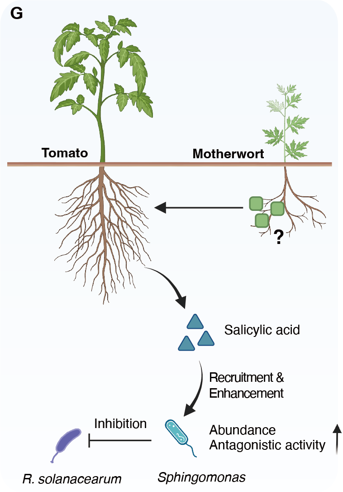

```{r setup, include=FALSE}
knitr::opts_chunk$set(echo = TRUE)
# Clean workspace
rm(list=ls()) 
# Set output directory
output_dir="./"
# Loading package
library(readxl)
```


## A. PCA

A)  Principal component analysis (PCA) showing compositional differences in root-derived metabolites across treatments.

```{r pca}
library(magrittr)
library(LorMe)
library(dplyr)
library(vegan)
library(ggplot2)

meta_table <- read.csv("../data/Supplementary Data 2.csv")
design <- read.csv("../data/design.csv")

all_dxtax_summary<-tax_summary(groupfile = design,inputtable = meta_table[,25:60],reads = T,taxonomytable = meta_table[,c(1,2)],outputtax = "standard")

innocu_dx_summary=object_config(taxobj = all_dxtax_summary,treat_location = 2,facet_location = 3,rep_location = 4)

meta_per<-innocu_dx_summary$Base_percent
rownames(meta_per)<-meta_per[,1]
meta_per <- t(meta_per[,-1]) %>% as.data.frame() 

pca_result <- prcomp(x = meta_per,center = T,scale. = T)

pca_result <- pca_result$x[,1:2] %>% as.data.frame()
pca_result$Group<-design$group
pca_result$Group <- factor(pca_result$Group,level=c('Mo.To','Co.To','Co.Mt'))
pca_result$Sample <- rownames(pca_result)
pca_result<-left_join(pca_result,design[,c(1,3)],by=c('Sample'='sampleID'))
pca_result$RS<-factor(pca_result$RS,levels = c('Y','N'))

pca_result$group2 <- paste(pca_result$Group,pca_result$RS,sep = "_")
adonis2(meta_per ~ RS * Group,data = pca_result,
        distance = "euclidean",
        permutations = 999, by = "terms")

Fig3A <- ggplot(pca_result, aes(x = PC1, y = PC2,color=group2,fill=group2)) +
  geom_vline(xintercept = 0,linetype = 2,linewidth=0.4,color="gray")+
  geom_hline(yintercept = 0,linetype = 2,linewidth=0.4,color="gray")+
  scale_color_manual(values = c("#4aac44","#ff8c00","#4aac44","#ff8c00","#4aac44","#ff8c00"))+
  scale_fill_manual(values = c("#4aac44","#ff8c00","#4aac44","#ff8c00","#4aac44","#ff8c00"))+
  scale_shape_manual(values = c(22,21,24))+
  geom_point(size = 1,aes(shape=Group),alpha=0.6) +
  labs(x="PC1 (31.0%)",y="PC2 (21.4%)")+
  annotate("text",x = -20,y = -25,size=2.5,
  label = "Crop R2: 0.14 ***
           RS± R2: 0.35 ***
           Crop * RS± R2: 0.48 ***")+
  theme_zg()+
  theme(
    axis.text = element_text(size = 7,color="black"),
    axis.title = element_text(face='bold',size = 7,color="black"),
    axis.ticks = element_line(size=0.25),
    # axis.ticks.x = element_blank(),
    axis.ticks.length = unit(0.05, "cm"),
    panel.border = element_rect(color = "black", fill = NA, size = 0.5),
    legend.position = "bottom")
ggsave(file.path(output_dir, "Fig3A.pdf"), Fig3A, width = 4, height = 4)
Fig3A
```


## B. Upregulated metabolites 

B)  Metabolites significantly upregulated in the rhizosphere of co-cultivated tomato compared to monocultured tomato.

```{r upregulated}
library(magrittr)
library(dplyr)
library(ggplot2)
library(ggpubr)

#Fig3B1
Fig3B <- read.csv("../data/Supplementary Data 3_Metabolite_screening_Figs3-5/Fig3B_Co.To(RS+) VS Mo.To(RS+).csv")

Fig3B_up <- Fig3B %>% filter(type == "up") 
Fig3B_down <- Fig3B %>% filter(type == "down") 

Fig3B1 <- ggplot(Fig3B_up[c(1:9,11:12,14:15),],aes(x=reorder(Metabolite,Log2.Fold.change.,decreasing=T),y=Log2.Fold.change.))+
  geom_segment(aes(x=Metabolite,xend=Metabolite,y=0,yend=Log2.Fold.change.),
               size=0.8,color="#e2e2e2",linetype="solid")+
  geom_point(aes(size=log10(Realtive.abundance.Co.To.)),color="darkgray")+
  scale_size(range = c(0.5,3))+
  scale_y_continuous(limits = c(0,6.5))+
  coord_flip()+
  theme_classic2()+
  theme(
        axis.text = element_text(size = 7,color="black"),
        axis.title = element_text(size = 7,color="black"),
        axis.ticks = element_line(size=0.25),
        axis.line = element_line(size=0.25),
        # axis.ticks.x = element_blank(),
        axis.ticks.length = unit(0.05, "cm"))+
  xlab("")+ylab("Log2(Fold Change)")
ggsave(file.path(output_dir, "Fig3B1.pdf"), Fig3B1, width = 5, height = 4)
Fig3B1

#Fig3B2
library(Rmisc)

Data_Fig3B2 <- read_excel("../data/Source Data Fig. 3.xlsx",sheet = "Fig3B")

SE<-summarySE(data = Data_Fig3B2,measurevar = "Sgm13 abundence(OD600)",groupvars = "treatment")
SE$treatment<-factor(SE$treatment,levels =c("Salicylic acid","L-Iditol","Tyrosine","Mannitol","Pentadecanoic acid","Xanthurenic acid"))

Fig3B2 <- ggplot(SE[-c(1),])+
  geom_vline(xintercept = SE[1,3],linetype = 2,color="black")+
  geom_errorbar(data=SE[-c(1),],aes(xmin=`Sgm13 abundence(OD600)`-se, xmax=`Sgm13 abundence(OD600)`+se,y=treatment),
                width=0,color="#a9a9a9",position=position_dodge(0),linewidth=0.4)+
  geom_point(data= Data_Fig3B2[-1:-6,],
             aes(x=`Sgm13 abundence(OD600)`,y=treatment),color="#a9a9a9",shape=16,size=0.7,alpha=0.5)+
  geom_point(aes(x=`Sgm13 abundence(OD600)`,y=treatment),color="#a9a9a9",shape=16,size=1.5)+
  theme_classic2()+
  theme(
    axis.text = element_text(size = 7,color="black"),
    axis.title = element_text(size = 7,color="black"),
    axis.ticks = element_line(size=0.25),
    axis.line = element_line(size=0.25),
    # axis.ticks.x = element_blank(),
    axis.ticks.length = unit(0.05, "cm"))+
  xlab("SPH4 growth (OD600)")+ylab("")
ggsave(file.path(output_dir, "Fig3B2.pdf"), Fig3B2, width = 4, height = 4)
Fig3B2
```


## C. Salicylic acid 

C)  Relative abundance of salicylic acid in the tomato rhizosphere under different treatments.

```{r SA}
library(Rmisc)
library(magrittr)
library(agricolae)
library(ggbreak)
library(ggplot2)

SA_abundance <- read.csv("SA_abundance.csv") %>% na.omit()
SA_abundance$Group<-factor(SA_abundance$Group,levels = c('Mo.To','Co.To','Co.Mt','Mo.To+','Co.To+','Co.Mt+'))

SE<-summarySE(data = SA_abundance,measurevar = "value",groupvars = "Group")
SE$Group<-factor(SE$Group,levels = c('Mo.To','Co.To','Co.Mt','Mo.To+','Co.To+','Co.Mt+'))
SE$x <- rep(c(1,2,3,5,6,7))

anova_result <- aov(log(value) ~ Group, data = SA_abundance)
tukey_result <- HSD.test(anova_result, "Group", group = TRUE)
tukey_labels <- tukey_result$groups
tukey_labels$name <- rownames(tukey_labels)
tukey_labels$name <- c(6,1,3,5,2,7)

Fig3C <- ggplot(data=SA_abundance,aes(x=x,y=value*10000))+
  stat_summary(fun = mean, geom = "bar", width = 0.7,aes(group = factor(x)),
               color=c('black'),fill=c('white'),linewidth=0.3) +
  geom_errorbar(data=SE,aes(ymin=value*10000-se*10000, ymax=value*10000+se*10000),
                width=0.2,position=position_dodge(0),alpha=0.8,linewidth=0.3)+
  geom_point(position = position_jitter(width = 0.15,height = 0), aes(color = factor(x),shape = factor(x)),
             size = 0.7) +
  geom_text(data = tukey_labels,aes(x=name,y=3,label = groups),size=2.4)+
  scale_color_manual(values = c("#4aac44","#4aac44","#4aac44","#ff8c00","#ff8c00","#ff8c00"))+
  scale_shape_manual(values = c(22,21,24,22,21,24))+
  scale_y_break(c(0.075,0.5,0.03,0.0001),scales = "free",space = 0.1,expand = c(0,0))+
  labs(x='',y='SA relative abundence(10-4)')+
  theme_classic2()+
  theme(axis.text.x = element_text(size = 7,color="black",angle=25,hjust=1),
        axis.text.y = element_text(size = 7,color="black"),
        axis.title = element_text(size = 7,color="black"),
        axis.ticks = element_line(size=0.25),
        axis.line = element_line(size=0.25),
        # axis.ticks.x = element_blank(),
        axis.ticks.length = unit(0.05, "cm"),
        legend.position = "none")
ggsave(file.path(output_dir, "Fig3C.pdf"), Fig3C, width = 4, height = 3)
Fig3C
```


## D. R. solanacearum

D)  Effects of salicylic acid, Sgm13, and both in combination on the growth of R. solanacearum.

```{r RS}
library(Rmisc)
library(magrittr)
library(agricolae)
library(ggplot2)
#Fig3D1 
Data_Fig3D1 <- read_excel("../data/Source Data Fig. 3.xlsx",sheet = "Fig3D1")
colnames(Data_Fig3D1) <- c("treatment","abundence")
SE<-summarySE(data = Data_Fig3D1,measurevar = "abundence",groupvars = "treatment")

anova_result <- aov(abundence ~ treatment, data = Data_Fig3D1)
tukey_result <- HSD.test(anova_result, "treatment")
tukey_labels <- tukey_result$groups
tukey_labels$name <- rownames(tukey_labels)

Fig3D1 <- ggplot(Data_Fig3D1,aes(x=reorder(treatment,-abundence),y=abundence))+
  stat_summary(fun = mean, geom = "bar", width = 0.7,linewidth=0.3,color="black",fill="white") +
  geom_errorbar(data=SE,aes(ymin=abundence-se, ymax=abundence+se),width=0.2,position=position_dodge(0),alpha=0.8,linewidth=0.3)+
  geom_point(position = position_jitter(width = 0.1,height = 0.15), color="#3d89a3",size = 0.5,shape = 21)  +
  coord_cartesian(ylim = c(3.7, 4.7))+
  geom_text(data = tukey_labels, aes(x = name, y = 4.7, label = groups),
            inherit.aes = FALSE, size = 3, color = "black")+
  theme_classic2()+
  theme(
    axis.text = element_text(size = 6,color="black"),
    axis.text.x = element_text(size = 6,color="black",angle=30,hjust = 1),
    axis.title = element_text(size = 7,color="black"),
    axis.ticks = element_line(size=0.25),
    axis.line = element_line(size=0.25),
    # axis.ticks.x = element_blank(),
    axis.ticks.length = unit(0.05, "cm"),
    legend.position = "none")+
  labs(x="",y="Ralstonia\nabundance (log10RFP)")
ggsave(file.path(output_dir, "Fig3D1.pdf"), Fig3D1, width = 2, height = 3)
Fig3D1


#Fig3D2 
Data_Fig3D2 <- read_excel("../data/Source Data Fig. 3.xlsx",sheet = "Fig3D2")
colnames(Data_Fig3D2) <- c("treatment","abundence")
SE<-summarySE(data = Data_Fig3D2,measurevar = "abundence",groupvars = "treatment")

anova_result <- aov(abundence ~ treatment, data = Data_Fig3D2)
tukey_result <- HSD.test(anova_result, "treatment")
tukey_labels <- tukey_result$groups
tukey_labels$name <- rownames(tukey_labels)

Fig3D2 <- ggplot(Data_Fig3D2,aes(x=reorder(treatment,-abundence),y=abundence))+
  stat_summary(fun = mean, geom = "bar", width = 0.7,linewidth=0.3,color="black",fill="white") +
  geom_errorbar(data=SE,aes(ymin=abundence-se, ymax=abundence+se),width=0.2,position=position_dodge(0),alpha=0.8,linewidth=0.3)+
  geom_point(position = position_jitter(width = 0.15,height = 0), color="#3d89a3",size = 0.5,shape = 21)  +
  coord_cartesian(ylim = c(0.2, 0.55))+
  geom_text(data = tukey_labels, aes(x = name, y = 0.53, label = groups),
            inherit.aes = FALSE, size = 3, color = "black")+
  theme_classic2()+
  theme(
    axis.text = element_text(size = 6,color="black"),
    axis.text.x = element_text(size = 6,color="black",angle=30,hjust = 1),
    axis.title = element_text(size = 7,color="black"),
    axis.ticks = element_line(size=0.25),
    axis.line = element_line(size=0.25),
    # axis.ticks.x = element_blank(),
    axis.ticks.length = unit(0.05, "cm"),
    legend.position = "none")+
  labs(x="",y="Ralstonia\nabundance (OD600)")
ggsave(file.path(output_dir, "Fig3D2.pdf"), Fig3D2, width = 2, height = 3)
Fig3D2

```


## E. Sphingomonas

E)  Effects of distinct concentrations of salicylic acid on the abundance of Sphingomonas in the rhizosphere of tomato in monoculture.

```{r Sphingomonas}
library(Rmisc)
library(magrittr)
library(agricolae)
library(ggplot2)

Data_Fig3E <- read_excel("../data/Source Data Fig. 3.xlsx",sheet = "Fig3E")
colnames(Data_Fig3E) <- c("sample","abundence","group")

SE<-summarySE(data = Data_Fig3E,measurevar = "abundence",groupvars = "group")

anova_result <- aov(abundence ~ group, data = Data_Fig3E)
tukey_result <- HSD.test(anova_result, "group")
tukey_labels <- tukey_result$groups
tukey_labels$name <- rownames(tukey_labels)

Fig3E <- ggplot(data=Data_Fig3E,
       aes(x=reorder(group,abundence),y=abundence))+
  stat_summary(fun = mean, geom = "bar", width = 0.7,linewidth=0.3,color="black",fill="white") +
  geom_errorbar(data=SE,aes(ymin=abundence-se, ymax=abundence+se),width=0.2,position=position_dodge(0),alpha=0.8,linewidth=0.3)+
  geom_point(position = position_jitter(width = 0.15,height = 0),color = "#3d89a3",size = 0.5,shape = 21)  +
  scale_x_discrete(breaks=c('CK','SA-L','SA-M','SA-H'),label=c('0','0.05','0.5','5'))+
  coord_cartesian(ylim = c(5.9,7))+
  geom_text(data = tukey_labels,aes(x=name,y=7,label = groups),size=2.2)+
  labs(x='',y='RS abundence (OD600)')+
  theme_classic2()+
  theme(
    axis.text = element_text(size = 6,color="black"),
    axis.text.x = element_text(size = 6,color="black",angle=30,hjust = 1),
    axis.title = element_text(size = 7,color="black"),
    axis.ticks = element_line(size=0.25),
    axis.line = element_line(size=0.25),
    # axis.ticks.x = element_blank(),
    axis.ticks.length = unit(0.05, "cm"),
    legend.position = "none")
ggsave(file.path(output_dir, "Fig3E.pdf"), Fig3E, width = 2, height = 3)
Fig3E
```


## F. Bacterial wilt incidence

F)  Bacterial wilt incidence in wild-type tomato (Moneymaker, WT), salicylic acid-deficient mutant NahG, and NahG plants treated with salicylic acid (SA) (n=4 biological replicates, 12 plants per treatment), and Sphingomonas abundance in the rhizosphere of wild-type tomato under the same conditions.

```{r incidence}
library(Rmisc)
library(magrittr)
library(agricolae)
library(ggplot2)

#Fig3F1
Data_Fig3F1 <- read_excel("../data/Source Data Fig. 3.xlsx",sheet = "Fig3F1")
Data_Fig3F1$group <- rep(c("WT","NahG","NahG+SA"),each=4)
Data_Fig3F1$group <- factor(Data_Fig3F1$group,levels = c("WT","NahG","NahG+SA"))
SE<-summarySE(data = Data_Fig3F1,measurevar = "incidence",groupvars = "group")

anova_result <- aov(incidence ~ group, data = Data_Fig3F1)
tukey_result <- HSD.test(anova_result, "group")
tukey_labels <- tukey_result$groups
tukey_labels$name <- rownames(tukey_labels)

Fig3F1 <- ggplot(Data_Fig3F1,aes(x=group,y=incidence))+
  stat_summary(fun = mean, geom = "bar", width = 0.7, color=c('black'),fill=c('white'),linewidth=0.3) +
  geom_errorbar(data=SE,aes(ymin=(incidence-se), ymax=(incidence+se)),width=0.2,position=position_dodge(0),alpha=0.8,linewidth=0.3)+
  geom_point(position = position_jitter(width = 0.25,height = 0),color="#3d89a3",size = 0.7,shape = 21) +
  geom_text(data = tukey_labels,aes(x=name,y=110,label = groups),size=2.4)+
  coord_cartesian(ylim = c(25,120))+
  labs(x='',y='Disease incidence (%)')+
  theme_classic2()+
  theme(axis.text.x = element_text(size = 7,color="black",angle=25,hjust = 1),
        axis.text.y = element_text(size = 7,color="black"),
        axis.title = element_text(size = 7,color="black"),
        axis.ticks = element_line(size=0.25),
        # axis.ticks.x = element_blank(),
        axis.ticks.length = unit(0.05, "cm"),
        axis.line = element_line(size=0.25),
        legend.position = "none")
ggsave(file.path(output_dir, "Fig3F1.pdf"), Fig3F1, width = 2, height = 3)
Fig3F1

#Fig3F2
Data_Fig3F2 <- read_excel("../data/Source Data Fig. 3.xlsx",sheet = "Fig3F2")
Data_Fig3F2$group <- rep(c("WT","NahG","NahG+SA"),each=6)
Data_Fig3F2$group <- factor(Data_Fig3F2$group,levels = c("WT","NahG","NahG+SA"))
colnames(Data_Fig3F2) <- c("sample","abundance","group")
SE<-summarySE(data = Data_Fig3F2,measurevar = "abundance",groupvars = "group")

anova_result <- aov(abundance ~ group, data = Data_Fig3F2)
tukey_result <- HSD.test(anova_result, "group")
tukey_labels <- tukey_result$groups
tukey_labels$name <- rownames(tukey_labels)

Fig3F2 <- ggplot(Data_Fig3F2,aes(x=group,y=abundance))+
  stat_summary(fun = mean, geom = "bar", width = 0.7, color=c('black'),fill=c('white'),linewidth=0.3) +
  geom_errorbar(data=SE,aes(ymin=(abundance-se), ymax=(abundance+se)),width=0.2,position=position_dodge(0),alpha=0.8,linewidth=0.3)+
  geom_point(position = position_jitter(width = 0.25,height = 0),color="#3d89a3",size = 0.7,shape = 21) +
  geom_text(data = tukey_labels,aes(x=name,y=6.6,label = groups),size=2.4)+
  coord_cartesian(ylim = c(5, 6.7))+
  labs(x='',y='Sphingomonas abundance\nlog10(CFU g-1 soil)')+
  theme_classic2()+
  theme(axis.text.x = element_text(size = 7,color="black",angle=25,hjust = 1),
        axis.text.y = element_text(size = 7,color="black"),
        axis.title = element_text(size = 7,color="black"),
        axis.ticks = element_line(size=0.25),
        # axis.ticks.x = element_blank(),
        axis.ticks.length = unit(0.05, "cm"),
        axis.line = element_line(size=0.25),
        legend.position = "none")
ggsave(file.path(output_dir, "Fig3F2.pdf"), Fig3F2, width = 2, height = 3)
Fig3F2
```


## G. Schematic illustration

G)  Schematic illustration showing that co-cultivation promotes salicylic acid secretion from tomato roots, leading to Sphingomonas enrichment and suppression of R. solanacearum.

