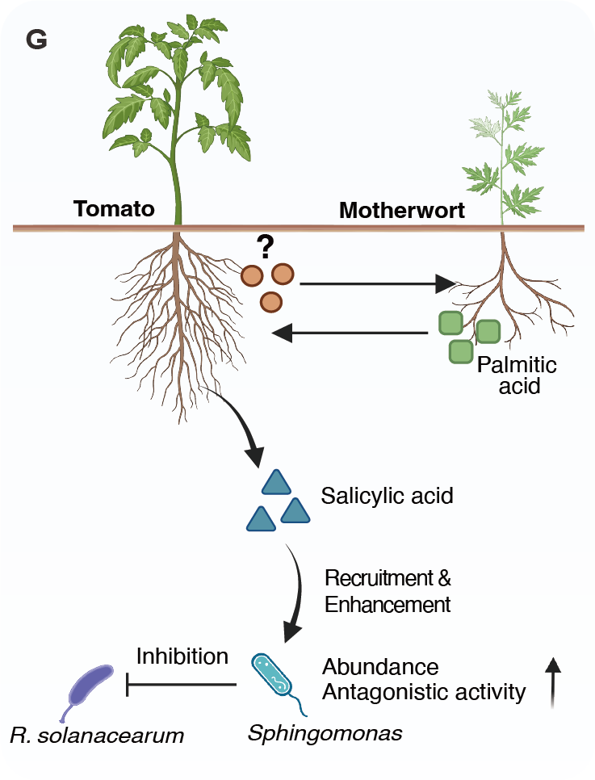

```{r setup, include=FALSE}
knitr::opts_chunk$set(echo = TRUE)
# Clean workspace
rm(list=ls()) 
# Set output directory
output_dir="./"
# Loading package
library(readxl)
```


## A. heatmap

A)  Among 49 metabolites co-upregulated in co-cultivated motherwort and tomato after R. solanacearum inoculation, 19 plant-associated compounds were classified by their predominant source. Three motherwort-derived metabolites that were enriched in co-cultivated tomato relative to monoculture were selected as candidate signals.

```{r heatmap}
library(magrittr)
library(LorMe)
library(ggplot2)
library(dplyr)
library(pheatmap)

#Fig4A1
meta_table <- read.csv("../data/Supplementary Data 2.csv")
design <- read.csv("../data/design.csv")

all_dxtax_summary<-tax_summary(groupfile = design,inputtable = meta_table[,25:60],reads = T,taxonomytable = meta_table[,c(1,2)],outputtax = "standard")

innocu_dx_summary=object_config(taxobj = all_dxtax_summary,treat_location = 2,facet_location = 3,rep_location = 4)

Fig4A1 <- read.csv("../data/Supplementary Data 3_Metabolite_screening_Figs3-5/Fig4A. Co.To(RS+ VS RS-),Co.Mt(RS+ VS RS-)comm up.csv")

heatmap <- innocu_dx_summary$Base_percent %>%filter(ID %in% Fig4A1$Com) %>%select(1, 20:25, 32:37) %>% left_join(Fig4A1[, 1:2], by = c("ID" = "Com"))
rownames(heatmap) <- heatmap$Name
heatmap <- as.matrix(heatmap[, 2:13])

pheatmap(t(heatmap),scale = "column",treeheight_row = 0,treeheight_col = 0,border_color = "white",
         color = colorRampPalette(c("#e2e2e2", "#3d89a3"))(50),filename = "Fig4A1.pdf",width = 6,height = 4)

#Fig4A2
Fig4A2 <- read.csv("../data/Supplementary Data 3_Metabolite_screening_Figs3-5/Fig4A. Co.To(RS+)_VS_Mo.To(RS+)_filter.csv")
Fig4A2$Metabolite <- factor(Fig4A2$Metabolite,levels=c("D-Raffinose","Sucrose","α-Lactose","Taurine","Flavin Adenine Dinucleotide","Gluconic acid","Ouabain","Palmitic acid","Maltotetraose"))

Fig4A2 <- ggplot(Fig4A2,aes(y=1,x=Metabolite,fill=Log2.Fold.change.Co.To.RS.._VS_Mo.To.RS..))+
  geom_tile(color="white",size=1)+
  scale_fill_gradient2(low="gray", high="#3d89a3", mid="#ffffff")+
  labs(x="",y="",fill="log2(fold change)")+
  theme_minimal()+
  theme(panel.grid.major=element_blank(),
        axis.line = element_blank(),
        axis.ticks = element_blank(),
        axis.text.y = element_blank(),
        axis.text.x = element_text(size = 7,angle = 30,hjust = 1),
        legend.key.size = unit(0.3,"cm"))
ggsave(file.path(output_dir, "Fig4A2.pdf"), Fig4A2, width = 4, height = 1.4)
Fig4A2
```


## B. bacterial wilt incidence

B)  Effects of exogenous gluconic acid, ouabain, and palmitic acid on tomato bacterial wilt incidence.

```{r incidence}
library(Rmisc)
library(agricolae)
library(ggpubr)
library(ggplot2)

Data_Fig4B <- read_excel("../data/Source Data Fig. 4.xlsx",sheet = "Fig4B")
Data_Fig4B$x <- paste(Data_Fig4B$group,Data_Fig4B$group2,sep = "_")
SE <- summarySE(Data_Fig4B, measurevar = "incidence", groupvars = c("group2", "x"))
Data_Fig4B$group <- factor(Data_Fig4B$group,levels = c("ck","low","mid","high"))

tukey_labels <- Data_Fig4B %>%
  group_by(group2) %>%
  group_modify(~ {
    fit <- aov(incidence ~ group, data = .x)
    result <- HSD.test(fit, "group", group = TRUE)$groups
    result$group <- rownames(result)
    result
  }) %>% ungroup()

Fig4B <- ggplot(Data_Fig4B,aes(x=group2,y=incidence))+
  stat_summary(fun = mean, geom = "bar", width = 0.6, color="black",
               fill="white",linewidth=0.3, aes(group=x),position = position_dodge(0.8)) +
  geom_errorbar(data=SE,aes(ymin=(incidence-se), ymax=(incidence+se),group=x),
                width=0.2,position = position_dodge(0.8),alpha=0.8,linewidth=0.3)+
  geom_point(position = position_jitterdodge(jitter.width = 0.25, dodge.width = 0.8),
             aes(color=group),size = 0.7,shape = 21)+
  scale_color_manual(values = c("#bebebe","#c1d6e0","#83afc1","#3d89a3"))+
  scale_y_continuous(expand = c(0,0),limits = c(0,110))+
  geom_text(data = tukey_labels, aes(x = group2, y = 105, label = groups, group = group), inherit.aes = FALSE, position = position_dodge(0.8), size = 3) +
  labs(x='Concentration (μmol/g soil)',y='Disease incidence (%)',fill="",color="")+
  theme_classic2()+
  theme(axis.text.x = element_text(size = 7,color="black"),
        axis.text.y = element_text(size = 7,color="black"),
        axis.title = element_text(size = 7,color="black"),
        axis.ticks = element_line(size=0.25),
        # axis.ticks.x = element_blank(),
        axis.ticks.length = unit(0.05, "cm"),
        axis.line = element_line(size=0.25),
        legend.position = "bottom")
ggsave(file.path(output_dir, "Fig4B.pdf"), Fig4B, width = 4, height = 3)
Fig4B
```


## C. palmitic acid on salicylic acid

C)  Effect of palmitic acid on salicylic acid levels in the tomato rhizosphere.

```{r PA}
library(Rmisc)
library(agricolae)
library(ggpubr)
library(ggplot2)

Data_Fig4C <- read_excel("../data/Source Data Fig. 4.xlsx",sheet = "Fig4C")
colnames(Data_Fig4C) <- c("sample","value","group")
Data_Fig4C$group<-factor(Data_Fig4C$group,levels = c('CK','low','mid','high'))

SE<-summarySE(data = Data_Fig4C,measurevar = "value",groupvars = "group")

anova_result <- aov(value ~ group, data = Data_Fig4C)
tukey_result <- HSD.test(anova_result, "group", group = TRUE)
tukey_labels <- tukey_result$groups
tukey_labels$name <- rownames(tukey_labels)

Fig4C <- ggplot(Data_Fig4C,aes(x=group,y=value*1000))+
  stat_summary(fun = mean, geom = "bar", width = 0.6, color="black",
               fill="white",linewidth=0.3, aes(group=group),position = position_dodge(0.8)) +
  geom_errorbar(data=SE,aes(ymin=(value-se)*1000, ymax=(value+se)*1000),
                width=0.2,position = position_dodge(0.8),alpha=0.8,linewidth=0.3)+
  geom_point(position = position_jitter(width = 0.2,height = 0),
             aes(color=group),size = 0.7,shape = 21) +
  geom_text(data = tukey_labels, aes(x = name, y = 4, label = groups), inherit.aes = FALSE, position = position_dodge(0.8), size = 3) +
  scale_color_manual(values = c("#bebebe","#c1d6e0","#83afc1","#3d89a3"))+
  scale_x_discrete(breaks=c('CK','low','mid','high'),label=c('0','0.05','0.5','5'))+
  labs(y='Salicylic acid \n(10-4μmol/g soil)',x='Palmitic acid (μmol/g soil)')+
  coord_cartesian(ylim = c(1.5,4))+
  theme_classic2()+
  theme(axis.text.x = element_text(size = 7,color="black"),
        axis.text.y = element_text(size = 7,color="black"),
        axis.title = element_text(size = 7,color="black"),
        axis.ticks = element_line(size=0.25),
        axis.ticks.length = unit(0.05, "cm"),
        axis.line = element_line(size=0.25),
        legend.position = "none")
ggsave(file.path(output_dir, "Fig4C.pdf"), Fig4C, width = 2, height = 3)
Fig4C
```


## D. PAL and ICS

D)  Effect of palmitic acid on expression of the salicylic acid biosynthesis genes PAL and ICS in tomato roots.

```{r PAL_and_ICS}
library(Rmisc)
library(agricolae)
library(ggpubr)
library(ggplot2)

#Fig4D1
Data_Fig4D1 <- read_excel("../data/Source Data Fig. 4.xlsx",sheet = "Fig4D(ICS)")
colnames(Data_Fig4D1) <- c("sample","value","group")
Data_Fig4D1$group<-factor(Data_Fig4D1$group,levels = c('CK','low','mid','high'))
SE<-summarySE(data = Data_Fig4D1,measurevar = "value",groupvars = "group")

anova_result <- aov(value ~ group, data = Data_Fig4D1)
tukey_result <- HSD.test(anova_result, "group", group = TRUE)
tukey_labels <- tukey_result$groups
tukey_labels$name <- rownames(tukey_labels)

Fig4D1 <- ggplot(data=Data_Fig4D1,aes(x=group,y=value))+
  stat_summary(fun = mean, geom = "bar", width = 0.6, color="black",
               fill="white",linewidth=0.3,position = position_dodge(0.8)) +
  geom_errorbar(data=SE,aes(ymin=(value-se), ymax=(value+se)),
                width=0.2,position = position_dodge(0.8),alpha=0.8,linewidth=0.3)+
  geom_point(position = position_jitter(width = 0.2,height = 0),
             aes(color=group),size = 0.7,shape = 21) +
  geom_text(data = tukey_labels, aes(x = name, y = 28, label = groups), inherit.aes = FALSE, position = position_dodge(0.8), size = 3) +
  scale_color_manual(values = c("#bebebe","#c1d6e0","#83afc1","#3d89a3"))+
  scale_x_discrete(breaks=c('CK','low','mid','high'),label=c('0','0.05','0.5','5'))+
  labs(x='',y='Relative transcript level')+
  scale_y_continuous(limits=c(0,33), expand = c(0,0))+
  theme_classic2()+
  theme(axis.text.x = element_text(size = 7,color="black"),
        axis.text.y = element_text(size = 7,color="black"),
        axis.title = element_text(size = 7,color="black"),
        axis.ticks = element_line(size=0.25),
        axis.ticks.length = unit(0.05, "cm"),
        axis.line = element_line(size=0.25),
        legend.position = "none")
ggsave(file.path(output_dir, "Fig4D1.pdf"), Fig4D1, width = 2, height = 3)
Fig4D1

#Fig4D2
Data_Fig4D2 <- read_excel("../data/Source Data Fig. 4.xlsx",sheet = "Fig4D(PAL)")
colnames(Data_Fig4D2) <- c("sample","value","group")
Data_Fig4D2$group<-factor(Data_Fig4D2$group,levels = c('CK','low','mid','high'))
SE<-summarySE(data = Data_Fig4D2,measurevar = "value",groupvars = "group")

anova_result <- aov(value ~ group, data = Data_Fig4D2)
tukey_result <- HSD.test(anova_result, "group", group = TRUE)
tukey_labels <- tukey_result$groups
tukey_labels$name <- rownames(tukey_labels)

Fig4D2 <- ggplot(data=Data_Fig4D2,aes(x=group,y=value))+
  stat_summary(fun = mean, geom = "bar", width = 0.6, color="black",
               fill="white",linewidth=0.3,position = position_dodge(0.8)) +
  geom_errorbar(data=SE,aes(ymin=(value-se), ymax=(value+se)),
                width=0.2,position = position_dodge(0.8),alpha=0.8,linewidth=0.3)+
  geom_point(position = position_jitter(width = 0.2,height = 0),
             aes(color=group),size = 0.7,shape = 21) +
  geom_text(data = tukey_labels, aes(x = name, y = 28, label = groups), inherit.aes = FALSE, position = position_dodge(0.8), size = 3) +
  scale_color_manual(values = c("#bebebe","#c1d6e0","#83afc1","#3d89a3"))+
  scale_x_discrete(breaks=c('CK','low','mid','high'),label=c('0','0.05','0.5','5'))+
  labs(x='',y='Relative transcript level')+
  scale_y_continuous(limits=c(0,33), expand = c(0,0))+
  theme_classic2()+
  theme(axis.text.x = element_text(size = 7,color="black"),
        axis.text.y = element_text(size = 7,color="black"),
        axis.title = element_text(size = 7,color="black"),
        axis.ticks = element_line(size=0.25),
        axis.ticks.length = unit(0.05, "cm"),
        axis.line = element_line(size=0.25),
        legend.position = "none")
ggsave(file.path(output_dir, "Fig4D2.pdf"), Fig4D2, width = 2, height = 3)
Fig4D2
```


## E. NahG+PA

E)  Bacterial wilt incidence in wild-type tomato (Moneymaker, WT), salicylic acid-deficient NahG tomato, and NahG plants treated with palmitic acid (PA) (n=4 biological replicates, 12 plants per treatment), and Sphingomonas abundance in the WT rhizosphere under the same treatments.

```{r NahG+PA}
library(Rmisc)
library(agricolae)
library(ggpubr)
library(ggplot2)

#Fig4E1
Data_Fig4E1 <- read_excel("../data/Source Data Fig. 4.xlsx",sheet = "Fig4E1")
Data_Fig4E1$group <- rep(c("WT","NahG","NahG+PA"),each=4)
Data_Fig4E1$group <- factor(Data_Fig4E1$group,levels = c("WT","NahG","NahG+PA"))
SE<-summarySE(data = Data_Fig4E1,measurevar = "incidence",groupvars = "group")

anova_result <- aov(incidence ~ group, data = Data_Fig4E1)
tukey_result <- HSD.test(anova_result, "group")
tukey_labels <- tukey_result$groups
tukey_labels$name <- rownames(tukey_labels)

Fig4E1 <- ggplot(Data_Fig4E1,aes(x=group,y=incidence))+
  stat_summary(fun = mean, geom = "bar", width = 0.7, color="black",fill="white",linewidth=0.3) +
  geom_errorbar(data=SE,aes(ymin=(incidence-se), ymax=(incidence+se)),width=0.2,position=position_dodge(0),alpha=0.8,linewidth=0.3)+
  geom_point(position = position_jitter(width = 0.25,height = 0), color="#3d89a3",size = 0.7,shape = 21) +
  geom_text(data = tukey_labels,aes(x=name,y=110,label = groups),size=2.4)+
  coord_cartesian(ylim = c(30,120))+
  labs(x='',y='Disease indence (%)')+
  theme_classic2()+
  theme(axis.text.x = element_text(size = 7,color="black",angle=25,hjust = 1),
        axis.text.y = element_text(size = 7,color="black"),
        axis.title = element_text(size = 7,color="black"),
        axis.ticks = element_line(size=0.25),
        # axis.ticks.x = element_blank(),
        axis.ticks.length = unit(0.05, "cm"),
        axis.line = element_line(size=0.25),
        legend.position = "none")
ggsave(file.path(output_dir, "Fig4E1.pdf"), Fig4E1, width = 2, height = 3)
Fig4E1

#Fig4E2
Data_Fig4E2 <- read_excel("../data/Source Data Fig. 4.xlsx",sheet = "Fig4E2")
Data_Fig4E2$group <- rep(c("WT","NahG","NahG+PA"),each=6)
Data_Fig4E2$group <- factor(Data_Fig4E2$group,levels = c("WT","NahG","NahG+PA"))
colnames(Data_Fig4E2) <- c("sample","abundance","group")
SE<-summarySE(data = Data_Fig4E2,measurevar = "abundance",groupvars = "group")

anova_result <- aov(abundance ~ group, data = Data_Fig4E2)
tukey_result <- HSD.test(anova_result, "group")
tukey_labels <- tukey_result$groups
tukey_labels$name <- rownames(tukey_labels)

Fig4E2 <- ggplot(Data_Fig4E2,aes(x=group,y=abundance))+
  stat_summary(fun = mean, geom = "bar", width = 0.7, color="black",fill="white",linewidth=0.3) +
  geom_errorbar(data=SE,aes(ymin=(abundance-se), ymax=(abundance+se)),width=0.2,position=position_dodge(0),alpha=0.8,linewidth=0.3)+
  geom_point(position = position_jitter(width = 0.25,height = 0), color="#3d89a3",size = 0.7,shape = 21) +
  geom_text(data = tukey_labels,aes(x=name,y=6.6,label = groups),size=2.4)+
  coord_cartesian(ylim = c(5,6.8))+
  labs(x='',y='Sphingomonas abundance\nlog10(CFU g-1 soil)')+
  theme_classic2()+
  theme(axis.text.x = element_text(size = 7,color="black",angle=25,hjust = 1),
        axis.text.y = element_text(size = 7,color="black"),
        axis.title = element_text(size = 7,color="black"),
        axis.ticks = element_line(size=0.25),
        # axis.ticks.x = element_blank(),
        axis.ticks.length = unit(0.05, "cm"),
        axis.line = element_line(size=0.25),
        legend.position = "none")
ggsave(file.path(output_dir, "Fig4E2.pdf"), Fig4E2, width = 2, height = 3)
Fig4E2

```


## F. abundance of palmitic acid

F)  Relative abundance of palmitic acid in the motherwort rhizosphere under the indicated treatments.

```{r palmitic}
library(Rmisc)
library(agricolae)
library(ggpubr)
library(ggplot2)

PA_abundance <- read.csv("PA_abundance.csv")
SE<-summarySE(data = PA_abundance,measurevar = "value",groupvars = c("group","RS"))
SE$x<-c(2,4+1,1,3+1)

anova_result <- aov(value ~ Group, data = PA_abundance)
tukey_result <- HSD.test(anova_result, "Group", group = TRUE)
tukey_labels <- tukey_result$groups
tukey_labels$name <- rownames(tukey_labels)
tukey_labels$name <- c(5,4,1,2)

Fig4F <- ggplot(data=PA_abundance,aes(x=x,y=value*10000))+
  stat_summary(fun = mean, geom = "bar", width = 0.7, color=c('black'),fill=c('white'),linewidth=0.3) +
  geom_errorbar(data=SE,aes(ymin=value*10000-se*10000, ymax=value*10000+se*10000),width=0.2,position=position_dodge(0),alpha=0.8,linewidth=0.3)+
  geom_point(position = position_jitter(width = 0.25,height = 0),aes(color=factor(Group),shape = factor(Group)),size = 0.7) +
  scale_y_continuous(limits = c(0,5),expand = c(0,0))+
  geom_text(data = tukey_labels,aes(x=name,y=4.5,label = groups),size=2.4)+
  scale_color_manual(values = c("#4aac44","#ff8c00","#4aac44","#ff8c00"))+
  scale_shape_manual(values = c(24,24,25,25))+
  scale_x_continuous(breaks = c(1, 2, 4, 5),
                     labels = c('Mo.Mt', 'Co.Mt', 'Mo.Mt', 'Co.Mt')) +
  labs(x='',y='Palmitic acid\nrelative abundence (10-4)')+
  theme_classic2()+
  theme(axis.text.x = element_text(size = 7,color="black",angle=25,hjust = 1),
        axis.text.y = element_text(size = 7,color="black"),
        axis.title = element_text(size = 7,color="black"),
        axis.ticks = element_line(size=0.25),
        # axis.ticks.x = element_blank(),
        axis.ticks.length = unit(0.05, "cm"),
        axis.line = element_line(size=0.25),
        legend.position = "none")
ggsave(file.path(output_dir, "Fig4F.pdf"), Fig4F, width = 2, height = 2)
Fig4F
```


## G. Schematic illustration

G)  Model showing that motherwort-derived palmitic acid promotes salicylic acid secretion from tomato roots.


