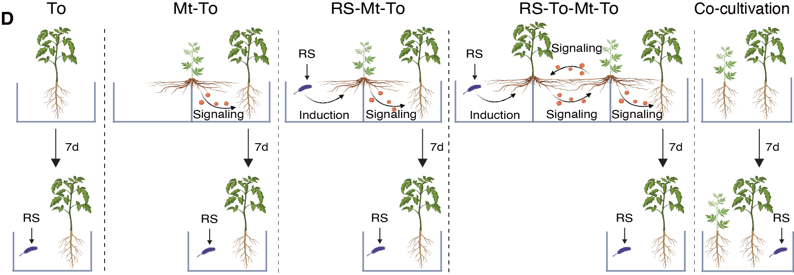

```{r setup, include=FALSE}
knitr::opts_chunk$set(echo = TRUE)
# Clean workspace
rm(list=ls()) 
# Set output directory
output_dir="./"
# Loading package
library(readxl)
```


## A. heatmap

A)  Among the nine metabolites predominantly secreted by tomato, 2-methylbutyl β-D-glucopyranoside was identified as a candidate signaling compound. This metabolite accumulated at significantly higher levels in the rhizosphere of co-cultivated motherwort under R. solanacearum infection compared to monocultured motherwort, suggesting its role in tomato-to-motherwort signaling.

```{r heatmap}
library(magrittr)
library(ggplot2)
library(dplyr)


#Fig5A2
Fig5A2 <- read.csv("../data/Supplementary Data 3_Metabolite_screening_Figs3-5/Fig5A. Co.Mt(RS+)_vs_Mo.Mt(RS+).csv")
Fig5A2$Metabolite <- factor(Fig5A2$Name,levels=c("6-Hydroxynicotinic acid","Nicotinic acid","Mevalonic acid","2-Methylbutyl beta-D-glucopyranoside","Betaine","Methionine sulfoxide","Zeranol", "N-Acetyl-1-aspartylglutamic acid", "Deoxyribose 5-Phosphate" ))

Fig5A2 <- ggplot(Fig5A2,aes(y=1,x=Name,fill=Log2.fold.change..Co.Mt.RS...vs.Mo.Mt.RS...))+
  geom_tile(color="white",size=1)+
  scale_fill_gradient2(low="gray", high="#3d89a3", mid="#ffffff")+
  labs(x="",y="",fill="log2(fold change)")+
  theme_minimal()+
  theme(panel.grid.major=element_blank(),
        axis.line = element_blank(),
        axis.ticks = element_blank(),
        axis.text.y = element_blank(),
        axis.text.x = element_text(size = 7,angle = 30,hjust = 1),
        legend.key.size = unit(0.3,"cm"))
ggsave(file.path(output_dir, "Fig5A2.pdf"), Fig5A2, width = 4, height = 1.6)
Fig5A2
```


## B. Palmitic acid accumulation

B)  Effect of exogenous 2-methylbutyl β-D-glucopyranoside (2MB-Glc) on palmitic acid accumulation in motherwort root tissues.

```{r PA}
library(agricolae)
library(Rmisc)
library(ggplot2)
library(ggbreak)
library(ggpubr)

Data_Fig5B <- read_excel("../data/Source Data Fig. 5.xlsx",sheet = "Fig5B")
Data_Fig5B$group <- factor(Data_Fig5B$group,levels = c("CK","low","mid","high"))
SE<-summarySE(data = Data_Fig5B,measurevar = "PA(μmol/g）",groupvars = "group")

anova_result <- aov(`PA(μmol/g）` ~ group, data = Data_Fig5B)
tukey_result <- HSD.test(anova_result, "group", group = TRUE)
tukey_labels <- tukey_result$groups
tukey_labels$name <- rownames(tukey_labels)

Fig5B <- ggplot(data=Data_Fig5B,aes(x=group,y=`PA(μmol/g）`))+
  stat_summary(fun = mean, geom = "bar", width = 0.6, color="black",fill="white",linewidth=0.3) +
  geom_errorbar(data=SE,aes(ymin=`PA(μmol/g）`-se, ymax=`PA(μmol/g）`+se),color="black",
                width=0.1,position=position_dodge(0),alpha=0.8,linewidth=0.3)+
  geom_point(position = position_jitter(width = 0.25,height = 0), color='#3d89a3',size = 0.7,shape = 21) +
  scale_x_discrete(breaks=c('CK','low','mid','high'),label=c('0','0.05','0.5','5'))+
  labs(x='2MB-Glc\n(umol/g soil)',y='Palmitic acid\n(umol/g root)')+
  geom_text(data = tukey_labels,aes(x=name,y=6.6,label = groups),size=2.4)+
  scale_y_break(c(0.4,5.2),scales = "fixed",space = 0.1)+
  theme_classic2()+
  theme(
    axis.text = element_text(size = 7,color="black"),
    axis.title = element_text(size = 7,color="black"),
    axis.ticks = element_line(size=0.25),
    axis.line = element_line(size=0.25),
    # axis.ticks.x = element_blank(),
    axis.ticks.length = unit(0.05, "cm"),
    legend.position = "none")
ggsave(file.path(output_dir, "Fig5B.pdf"), Fig5B, width = 3, height = 3)
Fig5B
```


## C. 2MB-Glc

C)  Effect of R. solanacearum infection on the relative abundance of 2-methylbutyl β-D-glucopyranoside in the tomato rhizosphere.

```{r 2MB-Glc}
library(agricolae)
library(Rmisc)
library(ggplot2)
library(ggpubr)

Data_Fig5C <- read.csv("~/Desktop/code/Fig5/2MB-Glc_abundance.csv")
SE<-summarySE(data = Data_Fig5C,measurevar = "value",groupvars = "group")

anova_result <- aov(value ~ group, data = Data_Fig5C)
tukey_result <- HSD.test(anova_result, "group", group = TRUE)
tukey_labels <- tukey_result$groups
tukey_labels$name <- rownames(tukey_labels)

Fig5C <- ggplot(data=Data_Fig5C,aes(x=group,y=value*100000))+
  stat_summary(fun = mean, geom = "bar", width = 0.6,aes(fill=RS),color=c('black'),fill=c('white'),linewidth=0.3) +
  geom_errorbar(data=SE,aes(ymin=(value-se)*100000, ymax=(value+se)*100000),width=0.2,position=position_dodge(0),alpha=0.8,linewidth=0.3)+
  geom_point(position = position_jitter(width = 0.25,height = 0), aes(color=RS),size = 0.7,shape = 21) +
  scale_y_continuous(expand = c(0,0),limits = c(0,6.5))+  
  scale_color_manual(values = c("#4aac44","#ff8c00"))+
  stat_compare_means(comparisons = list(c("Mo.To", "Mo.To+")), method = "t.test", label = "p.format", label.y = 6.2, size = 3) +
  labs(x='',y='2MB-Glc (umol/g soil)')+
  coord_cartesian(ylim = c(2,7))+
  theme_classic2()+
  theme(
    axis.text = element_text(size = 7,color="black"),
    axis.title = element_text(face='bold',size = 7,color="black"),
    axis.ticks = element_line(size=0.25),
    axis.line = element_line(size=0.25),
    axis.ticks.length = unit(0.05, "cm"),
    legend.position = "none")
ggsave(file.path(output_dir, "Fig5C.pdf"), Fig5C, width = 2, height = 3)
Fig5C
```


## D. Split-root assays

D)  Split-root assays used to investigate signaling cascade interactions between tomato and motherwort under five treatments: tomato monoculture (To); infection-free motherwort interaction (Mt-To); motherwort-to-tomato interaction under R. solanacearum infection(RS-Mt-To); tomato distress signal-mediated interaction through motherwort (RS-To-Mt-To); and co-cultivation (Co-cultivation)..




## E. Split-root assays result

E)  Split-root assays showing bacterial wilt incidence in tomato under different treatments.

```{r split}
library(agricolae)
library(Rmisc)
library(ggplot2)
library(ggpubr)

Data_Fig5E <- read_excel("../data/Source Data Fig. 5.xlsx",sheet = "Fig5E")
Data_Fig5E$incidence <- Data_Fig5E$incidence*100
Data_Fig5E$group <- factor(Data_Fig5E$group,levels = c("To","Mt-To","RS-Mt-To","RS-To-Mt-To","Co-cultivation"))
SE<-summarySE(data = Data_Fig5E,measurevar = "incidence",groupvars = "group")

anova_result <- aov(incidence ~ group, data = Data_Fig5E)
tukey_result <- HSD.test(anova_result, "group", group = TRUE)
tukey_labels <- tukey_result$groups
tukey_labels$name <- rownames(tukey_labels)

Fig5E <- ggplot(data=Data_Fig5E,aes(x=group,y=incidence))+
  stat_summary(fun = mean, geom = "bar", width = 0.6, color="black",fill="white",linewidth=0.3) +
  geom_errorbar(data=SE,aes(ymin=incidence-se, ymax=incidence+se),color="black",
                width=0.1,position=position_dodge(0),alpha=0.8,linewidth=0.3)+
  geom_point(position = position_jitter(width = 0.25,height = 0), color='#3d89a3',size = 0.7,shape = 21) +
  labs(x='',y='Disease incidence (%)')+
  coord_cartesian(ylim = c(0,120))+
  geom_text(data = tukey_labels,aes(x=name,y=110,label = groups),size=2.4)+
  theme_classic2()+
  theme(axis.text.x = element_text(size = 7,color="black",angle=25,hjust = 1),
        axis.text.y = element_text(size = 7,color="black"),
        axis.title = element_text(size = 7,color="black"),
        axis.ticks = element_line(size=0.25),
        axis.ticks.length = unit(0.05, "cm"),
        axis.line = element_line(size=0.25),
        legend.position = "none")
ggsave(file.path(output_dir, "Fig5E.pdf"), Fig5E, width = 2, height = 3)
Fig5E
```
